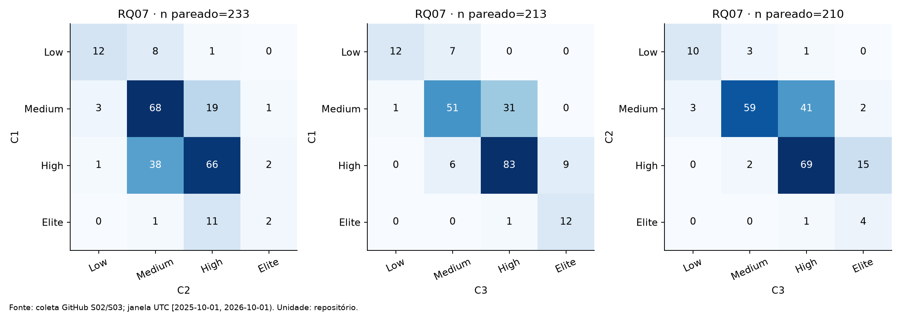

## 3. Resultados

A auditoria confirmou 311 identidades únicas e preservação dos três CSVs
humanos e do consenso. Recalculou independentemente Kappa de Fleiss e
CFR(b), incluindo seus 20.038 originais classificados como falhos,
6.406 não falhos, 677 censurados e 31 não avaliáveis. As cinco avaliações
da heurística foram conferidas; v5 manteve F1=0,724891, precisão=0,697479
e recall=0,754545. As análises abaixo usam a janela UTC
[2025-10-01, 2026-10-01) e o repositório como unidade estatística.

### RQ01 — Qual a frequência de deploy?

Usando releases estáveis/semana, a mediana foi 0,326027, com Q1=0,153425,
Q3=0,709589 e IQR=0,556164 (n=311). O mínimo foi 0,095890 e o máximo
131,101370. Foram 255/311 (82,0%) abaixo de uma release por semana.
As categorias foram Low=120, Medium=135, High=49 e Elite=7.

### RQ02 — Qual o tempo entre commit e entrega?

As duas variantes tiveram 261 repositórios válidos e 50 ausentes: 29 erros
de comparação e 21 erros de métrica. A mediana das medianas por release
foi 179,667222 h; por commit, 118,170278 h. Em 171 dos 261 pares o LT por
commit foi menor, em cinco foi igual e em 85 foi maior. Os quartis e IQR
estão na Tabela 1. A distribuição é assimétrica, com máximos de 10.488,387222 h
por release e 34.592,488194 h por commit. Os extremos foram preservados.

### RQ03 — Qual a taxa de falha das mudanças?

CFR(a), falhas/(falhas+sucessos) dos runs válidos, apresentou mediana
0,052863. CFR(b), originais seguidos por qualquer corretiva em até sete dias,
teve mediana 0,227273. Ambos têm n=311; CFR(b) foi maior em 228 pares,
igual em seis e menor em 77. O denominador agregado de CFR(b) foi 26.444;
essa razão agregada não substitui a distribuição por repositório. Censuras
e contexto insuficiente ficaram fora do denominador, sem imputação negativa.

### RQ04 — Qual o tempo de recuperação?

A mediana foi 3,302361 h (n=286), com Q1=0,830417, Q3=18,797743 e
IQR=17,967326. Dos 25 ausentes, 23 repositórios não tiveram episódios
observados e dois tiveram somente episódios censurados. Houve 10.254
episódios, dos quais 114 (1,11%) censurados. A mediana considera os
10.140 resolvidos; o máximo entre medianas foi 2.369,781944 h.

**Tabela 1 — Distribuições das métricas por repositório.**

| Métrica | Unidade | n | Ausentes | Mediana | Q1 | Q3 | IQR |
|---|---|---:|---:|---:|---:|---:|---:|
| DF | releases/semana | 311 | 0 | 0,326027 | 0,153425 | 0,709589 | 0,556164 |
| LT por release | h | 261 | 50 | 179,667222 | 44,895417 | 526,769583 | 481,874167 |
| LT por commit | h | 261 | 50 | 118,170278 | 27,719167 | 425,645000 | 397,925833 |
| CFR(a) | fração | 311 | 0 | 0,052863 | 0,021919 | 0,114460 | 0,092540 |
| CFR(b) | fração | 311 | 0 | 0,227273 | 0,083333 | 0,471691 | 0,388357 |
| Recuperação | h | 286 | 25 | 3,302361 | 0,830417 | 18,797743 | 17,967326 |

Fonte: [descriptive.csv](../data/processed/s03/descriptive.csv), que também
preserva mínimos e máximos. As [distribuições](../figures/s03/rq01_04_distributions.pdf)
usam transformação log(1+x) quando necessária, identificada nos eixos.

**Tabela 2 — Classificação DORA; geral C1 exige quatro métricas.**

| Métrica | Low | Medium | High | Elite | Ausentes |
|---|---:|---:|---:|---:|---:|
| DF | 120 | 135 | 49 | 7 | 0 |
| LT release | 50 | 86 | 74 | 51 | 50 |
| LT commit | 44 | 72 | 84 | 61 | 50 |
| CFR(a) | 8 | 13 | 36 | 254 | 0 |
| CFR(b) | 82 | 35 | 83 | 111 | 0 |
| Recuperação | 14 | 40 | 151 | 81 | 25 |
| Geral C1 | 21 | 93 | 111 | 14 | 72 |

A classificação geral teve 239 válidos, com piso da mediana dos quatro
escores. Não foi atribuída categoria geral aos 72 incompletos.

### RQ05 — DF está associada a CFR?

Para DF×CFR(a), rho=0,063406 (n=311), associação positiva de magnitude
pequena, p assintótico=0,264938, p de permutação=0,2639 e p_Holm=0,2639.
Não houve evidência de associação ao nível de 5%. Para DF×CFR(b),
rho=0,651374, associação positiva expressiva, p assintótico=6,204×10⁻³⁹,
p de permutação=0,0001 e p_Holm=0,0002 (n=311). Esse p de permutação é
limitado pela resolução de 9.999 permutações; não significa p=0.
As [dispersões](../figures/s03/rq05_scatter.pdf) mostram os pares, com
frequência em escala logarítmica. Não se infere causalidade.

### RQ06 — Quais fatores estão associados às métricas?

Estrelas, contribuidores e idade estavam disponíveis nos 311 repositórios.
Usamos quartis globais sem dividir empates. Os grupos de estrelas e idade
tiveram 78/78/77/78 casos, e contribuidores 79/77/77/78 antes da exclusão
por métrica. Todos os testes efetivos foram Kruskal–Wallis, com quatro
grupos. A tabela apresenta a família principal de 12 testes, com Holm
conjunto; ε²=H/(n−1).

| Fator | Métrica | n | H | p bruto | p_Holm | ε² |
|---|---|---:|---:|---:|---:|---:|
| Estrelas | DF | 311 | 4,345898 | 0,226455 | 0,905818 | 0,014019 |
| Estrelas | LT release | 261 | 4,193805 | 0,241283 | 0,905818 | 0,016130 |
| Estrelas | CFR(a) | 311 | 5,402540 | 0,144585 | 0,722927 | 0,017428 |
| Estrelas | Recuperação | 286 | 1,140547 | 0,767296 | 1,000000 | 0,004002 |
| Contribuidores | DF | 311 | 8,653335 | 0,034273 | 0,205640 | 0,027914 |
| Contribuidores | LT release | 261 | 13,052729 | 0,004524 | 0,045240 | 0,050203 |
| Contribuidores | CFR(a) | 311 | 0,257729 | 0,967772 | 1,000000 | 0,000831 |
| Contribuidores | Recuperação | 286 | 11,978817 | 0,007456 | 0,059649 | 0,042031 |
| Idade | DF | 311 | 39,494012 | 1,364×10⁻⁸ | 1,500×10⁻⁷ | 0,127400 |
| Idade | LT release | 261 | 43,563239 | 1,869×10⁻⁹ | 2,242×10⁻⁸ | 0,167551 |
| Idade | CFR(a) | 311 | 10,514176 | 0,014665 | 0,102655 | 0,033917 |
| Idade | Recuperação | 286 | 12,799471 | 0,005091 | 0,045819 | 0,044910 |

As medianas de LT nos quartis extremos de contribuidores foram 126,34 e
339,18 h. Por idade, as medianas de DF foram 0,681/0,364/0,211/0,268 e
as de LT 44,53/203,47/211,64/366,06 h. Recuperação por idade teve medianas
1,53/3,18/4,18/7,22 h. Esses padrões descritivos não identificam pares
estatisticamente distintos sem teste posterior.

Na família suplementar CFR(b), os testes de estrelas, contribuidores e
idade tiveram respectivamente H=2,516435/5,149467/47,886286;
p_Holm=0,472328/0,322348/6,754×10⁻¹⁰; ε²=0,008118/0,016611/0,154472,
todos com n=311. Os [resultados completos](../data/processed/s03/factor_tests.csv),
[n, medianas e IQR por grupo](../data/processed/s03/factor_groups.csv) e
[cortes](../data/processed/s03/factor_cutpoints.csv) permitem inspecionar
essas comparações, junto aos três boxplots em `figures/s03/rq06_*`.

### RQ07 — Quanto a classificação depende da definição?

Mantivemos C1=estáveis/LT release/CFR(a), C2=estáveis+pré-releases/LT
commit/CFR(b) e C3=tags/LT commit/CFR(a), com recuperação comum de CI.
Foram usados 27.152, 29.007 e 37.051 eventos respectivamente. C3 usa a data
autoral do commit da tag. O snapshot contém 33.154 pares únicos: 20.084
reutilizados por SHAs coincidentes, 3.059 idênticos e 10.011 complementares,
incluindo 31 pares de fronteira. Destes complementares, 7.399 ficaram
completos, 2.572 inválidos/erro e 40 com compare 404. O diagnóstico integral
preserva os motivos, incluindo divergência de ancestralidade e um HTTP 422.

LT foi calculável em C2 para 255 casos (56 ausentes) e em C3 para 267
(44 ausentes). Foram 233 categorias gerais válidas em C2 e 243 em C3;
C1 teve 239. A tabela usa o mesmo conjunto válido dentro de cada par.

| Comparação geral | n pareado | Mudanças | % | Kappa linear |
|---|---:|---:|---:|---:|
| C1 × C2 | 233 | 85 | 36,480687 | 0,475159 |
| C1 × C3 | 213 | 55 | 25,821596 | 0,669413 |
| C2 × C3 | 210 | 68 | 32,380952 | 0,553459 |

Entre C1 e C2, DF mudou em 19/311 (6,11%; κ=0,925573), LT em
121/255 (47,45%; κ=0,520657) e CFR em 210/311 (67,52%; κ=0,015745).
Entre C1 e C3, DF mudou em 38/311 (12,22%; κ=0,840384) e LT em
110/234 (47,01%; κ=0,514994). LT C2×C3 mudou em 17/231
(7,36%; κ=0,931665). CFR(a) C1×C3 e recuperação em todos os pares são
idênticos por construção; isso não é evidência independente de robustez.

Os [15 resultados pareados](../data/processed/s03/sensitivity.csv) e as
classificações individuais preservam todos os denominadores. A comparação
suplementar na interseção comum das três categorias gerais controla a
mudança de composição entre pares, sem substituir a análise principal.
Nessa interseção de 210 casos, C1×C2 teve 37,62% de mudanças e κ=0,458864;
C1×C3, 25,71% e κ=0,672689; C2×C3 manteve 32,38% e κ=0,553459.

### Inovação — Quão precisas são as estimativas?

O bootstrap de repositórios produziu 2.000 réplicas válidas em cada uma
das cinco estimativas, com seed 42. Os ICs percentis 95% foram:

| Estimativa | Valor | Limite inferior | Limite superior |
|---|---:|---:|---:|
| Mediana DF | 0,326027 | 0,287671 | 0,364384 |
| Mediana CFR(a) | 0,052863 | 0,043300 | 0,061146 |
| Mediana CFR(b) | 0,227273 | 0,200000 | 0,272727 |
| rho DF×CFR(a) | 0,063406 | −0,051498 | 0,179665 |
| rho DF×CFR(b) | 0,651374 | 0,577618 | 0,716265 |

Os intervalos quantificam incerteza amostral condicional às definições;
o de DF×CFR(a) inclui zero. [Tabela](../data/processed/s03/bootstrap.csv)
e [figura](../figures/s03/bootstrap_intervals.pdf) preservam o método.

### RQ08 — Qual a proporção de releases corretivas?

O retrabalho foi calculável integralmente em 274 repositórios: mediana
0,421053, Q1=0,237582, Q3=0,600000 e IQR=0,362418. Em 37 repositórios
com alguma classificação indisponível, a taxa pontual permaneceu ausente,
com limites identificáveis reportados por caso. Essa razão conta corretivas,
não originais seguidos por corretiva, e portanto não equivale a CFR(b).
Os [dados](../data/processed/s03/rework.csv) e o
[gráfico](../figures/s03/rq08_rework.pdf) explicitam essa distinção.
